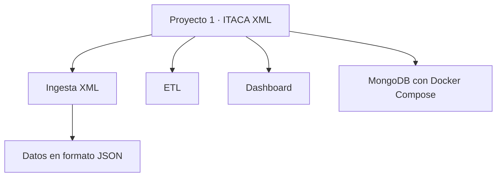
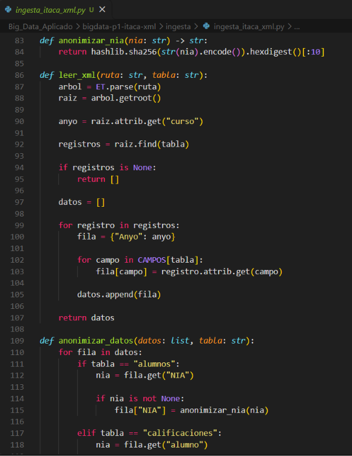
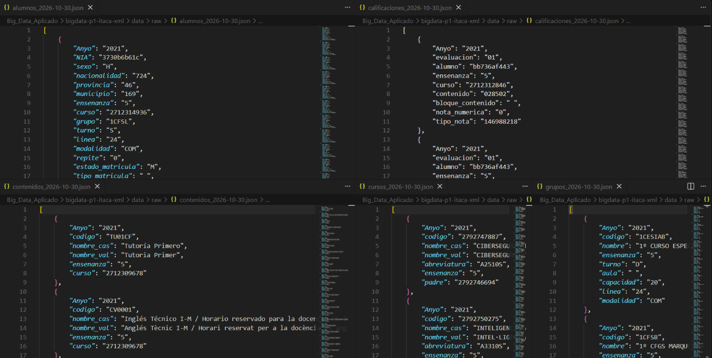
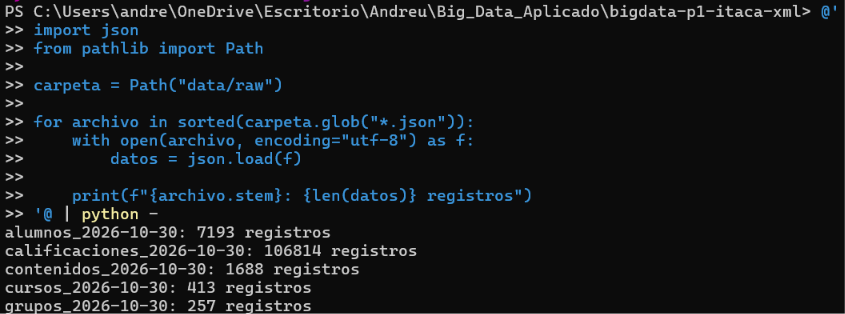
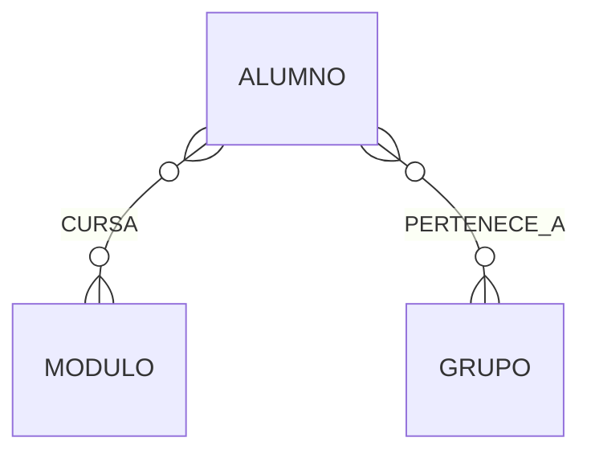
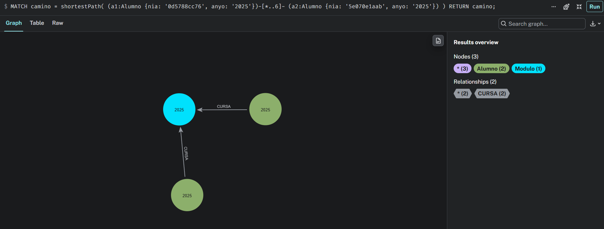
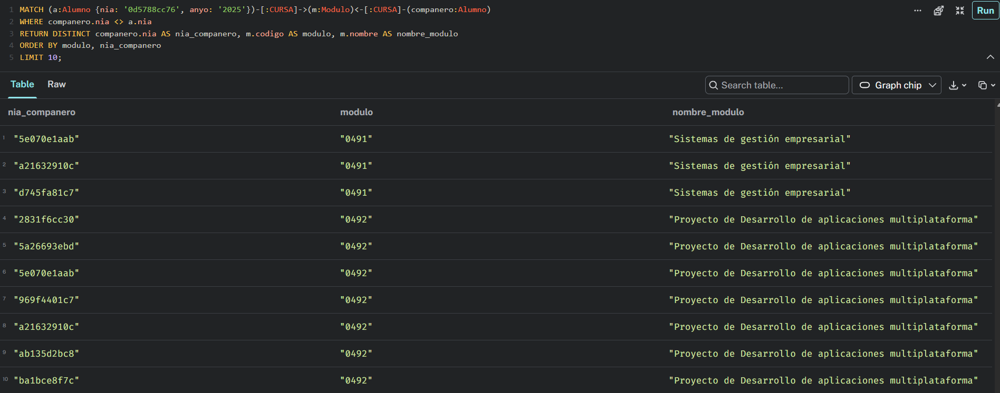
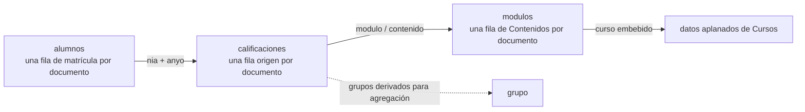
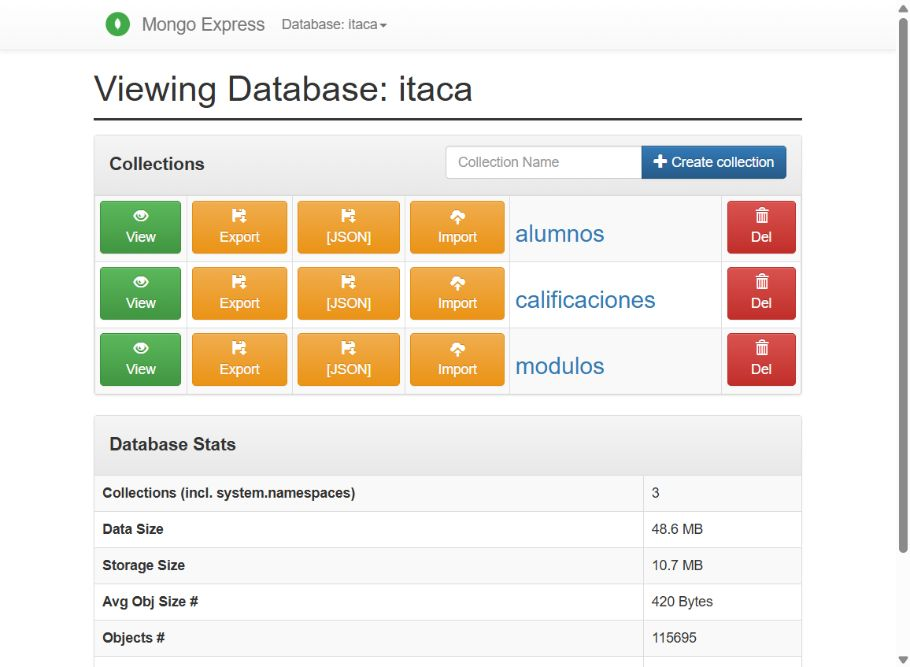
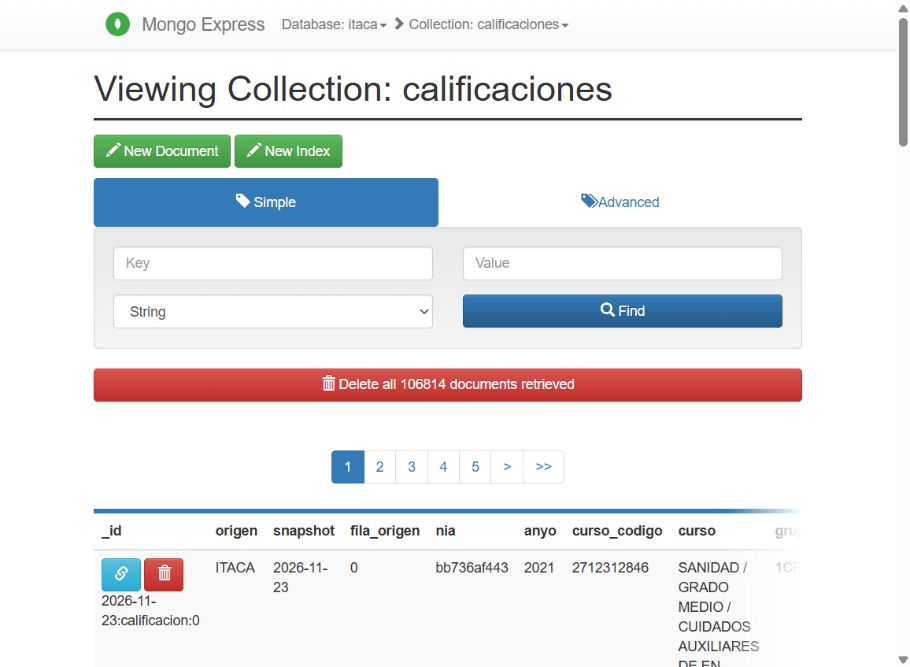

# Proyecto 1 · ITACA XML

## Descripción y objetivo

Este repositorio corresponde al Proyecto 1 del módulo de Big Data.

El proyecto se basa en datos de ITACA relacionados con estudiantes, cursos, contenidos, grupos y calificaciones.

## Arquitectura



El diagrama muestra la estructura inicial del repositorio y sirve como referencia para la organización de los distintos componentes. Dicha estructura podrá evolucionar a medida que se desarrolle el proyecto.

## Estructura del repositorio

```text
bigdata-p1-itaca-xml/
├── data/
│   ├── exportaciones/
│   │   ├── 2021-22/
│   │   ├── 2022-23/
│   │   ├── 2023-24/
│   │   ├── 2024-25/
│   │   └── 2025-26/
│   └── raw/
├── ingesta/
│   └── ingesta_itaca_xml.py
├── etl/
│   ├── aplanar_cursos.py
│   ├── cargar_mongodb.py
│   ├── cargar_neo4j.py
│   └── modulos_con_curso.py
├── dashboard/
├── evidencias/
│   ├── 01_script_ingesta.png
│   ├── 02_xml_exportaciones.png
│   ├── 03_ejecucion_ingesta.png
│   ├── 04_json_generados.png
│   ├── 05_validacion_registros.png
│   ├── mongodb/
│   └── grafos/
├── .gitignore
├── docker-compose.yml
└── README.md
```

Las carpetas `data/exportaciones/`, `data/raw/` y `data/trusted/` se utilizan para trabajar con los datos localmente.

Están excluidas del repositorio mediante `.gitignore`, por lo que los archivos XML y JSON, incluidos los ficheros intermedios aplanados, no se suben a GitHub.

La carpeta `evidencias/` contiene las capturas realizadas durante la práctica.

## Entorno de trabajo

El repositorio incluye un archivo `docker-compose.yml` para desplegar una instancia de MongoDB mediante Docker Compose.

Para la ingesta se utiliza Python y la librería `xml.etree.ElementTree`, que permite leer y procesar los archivos XML.

## Fuentes de datos

Los datos proceden de las exportaciones XML de ITACA, organizadas por curso académico dentro de `data/exportaciones/`.

Cada carpeta contiene los archivos correspondientes a las cinco tablas utilizadas en el proyecto:

| Archivo XML          | Tabla          | Información                                                                                         |
| -------------------- | -------------- | --------------------------------------------------------------------------------------------------- |
| `alumnos.xml`        | Alumnos        | NIA, sexo, nacionalidad, provincia, municipio, enseñanza, curso, grupo, turno y datos de matrícula. |
| `calificaciones.xml` | Calificaciones | Evaluación, alumno, enseñanza, curso, contenido, bloque de contenido, nota numérica y tipo de nota. |
| `contenidos.xml`     | Contenidos     | Código, nombre en castellano y valenciano, enseñanza y curso.                                       |
| `cursos.xml`         | Cursos         | Código, nombre en castellano y valenciano, abreviatura, enseñanza y curso padre.                    |
| `grupos.xml`         | Grupos         | Código, nombre, enseñanza, turno, aula, capacidad, línea y modalidad.                               |

Las exportaciones disponibles corresponden a los cursos académicos 2021-22, 2022-23, 2023-24, 2024-25 y 2025-26.

## Ingesta de datos

La ingesta se realiza mediante el script `ingesta/ingesta_itaca_xml.py`.

El proceso recorre las carpetas de los cinco cursos académicos y lee los archivos XML de cada una de las tablas.

Los registros se acumulan por tabla y se guardan en archivos JSON dentro de `data/raw/`.

El campo `Anyo` se obtiene del atributo `curso` de la cabecera de cada XML.

### Anonimización del NIA

Para evitar conservar el NIA original, se utiliza una función basada en SHA-256 que devuelve los primeros 10 caracteres del hash.

La anonimización se aplica tanto al campo `NIA` de la tabla de alumnos como al campo `alumno` de las calificaciones.

El hash se calcula una sola vez por cada NIA y se reutiliza mediante una caché, manteniendo la misma referencia anonimizada entre ambas tablas.

### Validación de claves

Después de procesar los XML, se comprueba que las referencias de las calificaciones existan en las tablas correspondientes:

- El campo `alumno` debe existir en los NIA de la tabla de alumnos.
- El campo `contenido` debe existir en los códigos de la tabla de contenidos.

La validación registra los resultados mediante `logging`, diferenciando los errores de referencias a alumnos y a contenidos.

En la última ejecución se detectaron 133 calificaciones asociadas a 6 identificadores de alumno que no aparecen en ninguna de las cinco exportaciones disponibles. Se comprobó que esos identificadores tampoco aparecen en los XML originales de alumnos.

No se eliminan esas calificaciones: se conservan los registros y se deja constancia de la incidencia mediante un aviso en el log.

No se encontraron referencias a contenidos inexistentes.

### Archivos generados

La ejecución del script genera cinco archivos JSON:

- `alumnos_FECHA.json`
- `calificaciones_FECHA.json`
- `contenidos_FECHA.json`
- `cursos_FECHA.json`
- `grupos_FECHA.json`

Los archivos se guardan en `data/raw/` y contienen los registros acumulados de los cinco cursos académicos.

### Ejecución

Desde la raíz del repositorio se ejecuta:

```bash
python ingesta/ingesta_itaca_xml.py
```

El script muestra mediante logs los archivos procesados, el número de registros leídos, los resultados de la validación, los archivos JSON generados y el estado final del proceso.

## Evidencias

### 1. Script de ingesta

Captura del script utilizado para procesar los archivos XML.



### 2. Exportaciones XML

Captura de las carpetas con los archivos XML de los cinco cursos académicos.


### 3. Ejecución de la ingesta

Captura de la ejecución del script y de los mensajes de logging.


### 4. Archivos JSON generados

Captura de los cinco archivos JSON resultantes de la ingesta.



### 5. Validación de registros

Captura de las comprobaciones realizadas sobre las referencias de alumnos y contenidos.



## Estado actual

- [x] Repositorio Git inicializado en la rama `main`.
- [x] Carpetas iniciales creadas.
- [x] Archivo `.gitignore` creado.
- [x] Archivo `docker-compose.yml` creado.
- [x] Contenedor de MongoDB iniciado.
- [x] Script de ingesta XML creado.
- [x] Datos de los cinco cursos académicos procesados.
- [x] NIA anonimizado en alumnos y calificaciones.
- [x] Hash del NIA reutilizado mediante una caché.
- [x] Cinco archivos JSON generados.
- [x] Logging incorporado para registrar la lectura, los errores y la escritura de archivos.
- [x] Validación de referencias entre alumnos, calificaciones y contenidos.
- [x] Incidencia de 133 calificaciones con 6 identificadores de alumno no encontrados identificada y documentada.
- [x] Capturas de las evidencias incorporadas al README.

## Práctica · Bloque 2: grafos con Neo4j

La práctica modela las relaciones entre alumnos, módulos y grupos a partir de los JSON anonimizados de `data/raw/`. El grafo se construye desde los datos ya ingeridos, sin volver a leer los XML de origen.

### Modelo



- `Alumno` representa a una persona anonimizada dentro de un año académico. Sus propiedades académicas incluyen ciclo, grado, familia y turno; los códigos de curso del fichero de alumnos se conservan como contexto.
- `Modulo` conserva el código y nombre del contenido, además del curso al que pertenece.
- `Grupo` se identifica por año académico y código.
- `CURSA` enlaza alumno y módulo y guarda evaluación, nota, bloque de contenido y tipo de nota.
- `PERTENECE_A` enlaza alumno y grupo.

La identidad de `Alumno` es `(nia, anyo)`; la de `Modulo`, `(codigo, anyo, curso_codigo)`; y la de `Grupo`, `(codigo, anyo)`. Los JSON acumulan varios cursos académicos y un NIA o código puede reaparecer en años distintos.

Los campos `ciclo`, `grado` y `familia` del alumno se derivan recorriendo la jerarquía `padre` de `cursos`. Si hay varios códigos de curso para un mismo NIA y año, se guardan todos en `cursos_codigo` y se usa el más frecuente para describir el perfil del nodo. En cambio, las calificaciones se enlazan con el alumno por `alumno` + `Anyo`, y con el módulo por `contenido` + `Anyo` + `curso`.

Esta diferencia es necesaria con los datos reales: en la instantánea usada, 1.992 calificaciones comparten NIA y año con un alumno, pero su código `curso` no coincide con el código del registro de alumno. Exigir que coincidan esos cursos perdería esas relaciones. Quedan sin enlazar 55 registros cuyo NIA solo aparece en otro año y 133 cuyo NIA no aparece en alumnos, incidencias que ya identifica la validación de la ingesta.

### Preparación y despliegue

Desde la raíz de este proyecto, copia `.env.example` a `.env` y sustituye el valor de `NEO4J_PASSWORD` por una contraseña local de al menos ocho caracteres. `.env` ya está excluido de Git. En este entorno ya se ha creado el `.env` local, así que no lo sobrescribas.

Instala las dependencias en el entorno Python que uses:

```bash
python -m venv .venv
.\.venv\Scripts\python.exe -m pip install -r requirements.txt
```

Arranca Neo4j y MongoDB solo si necesitas ambos servicios; para esta práctica basta Neo4j:

```bash
docker compose up -d neo4j
```

Abre <http://localhost:7474> e inicia sesión como `neo4j` con la contraseña definida en `.env`.

### Carga de datos

Ejecuta desde la raíz de este proyecto; el script también resuelve las rutas de los datos a partir de su propia ubicación:

```bash
.\.venv\Scripts\python.exe etl/cargar_neo4j.py
```

El script selecciona la fecha más reciente que tenga los cinco JSON (`alumnos`, `grupos`, `contenidos`, `cursos` y `calificaciones`). Usa `MERGE` y restricciones únicas compuestas (`Alumno`: NIA+año; `Modulo`: código+año+curso; `Grupo`: código+año), así se puede repetir la carga sin duplicar nodos ni relaciones.

La ingesta anterior documenta calificaciones asociadas a algunos alumnos ausentes y referencias de grupo vacías. El cargador omite relaciones que no puede resolver y registra el número de filas omitidas por alumno, módulo o ambos. No inventa nodos para referencias sin correspondencia.

### Consultas Cypher

Primero, selecciona un NIA y un año presentes en el grafo. En Neo4j Browser:

```cypher
MATCH (a:Alumno)
RETURN a.nia AS nia, a.anyo AS anyo
LIMIT 10;
```

Define parámetros con uno de esos valores:

```cypher
:param nia => '0d5788cc76';
:param anyo => '2025';
:param otro_nia => '5e070e1aab';
```

Estos NIA son identificadores anonimizados de la instantánea `2026-11-23`. Para la consulta d se cambia temporalmente `nia` por `344a5ec7ab`.

#### a) Compañeros de módulo

```cypher
MATCH (a:Alumno {nia: $nia, anyo: $anyo})-[:CURSA]->(m:Modulo)<-[:CURSA]-(companero:Alumno)
WHERE companero.nia <> a.nia
RETURN DISTINCT companero.nia AS nia_companero, m.codigo AS modulo, m.nombre AS nombre_modulo
ORDER BY modulo, nia_companero;
```

La consulta parte de la matrícula elegida, recorre una relación `CURSA` hasta un módulo y vuelve por `CURSA` a los demás alumnos conectados a ese módulo.

#### b) Módulos en común entre dos alumnos

```cypher
MATCH (a1:Alumno {nia: $nia, anyo: $anyo})-[:CURSA]->(m:Modulo)<-[:CURSA]-(a2:Alumno {nia: $otro_nia, anyo: $anyo})
RETURN DISTINCT m.codigo AS modulo, m.nombre AS nombre_modulo
ORDER BY modulo;
```

El mismo nodo `m` debe estar conectado a ambas matrículas, por lo que solo devuelve módulos compartidos.

#### c) Camino más corto entre dos alumnos

```cypher
MATCH camino = shortestPath(
  (a1:Alumno {nia: $nia, anyo: $anyo})-[*..6]-(a2:Alumno {nia: $otro_nia, anyo: $anyo})
)
RETURN camino;
```

El patrón sin tipo de relación permite recorrer tanto `CURSA` como `PERTENECE_A`, en cualquiera de las direcciones. El límite de seis relaciones evita una búsqueda sin cota. Si no existe conexión dentro de ese límite, no se devuelve camino.

#### d) Alumnos con perfil similar en otro grupo

```cypher
MATCH (a1:Alumno {nia: $nia, anyo: $anyo})-[:PERTENECE_A]->(g1:Grupo)
MATCH (a2:Alumno {anyo: $anyo})-[:PERTENECE_A]->(g2:Grupo)
WHERE a1.nia <> a2.nia
  AND a1.ciclo = a2.ciclo
  AND a1.grado = a2.grado
  AND a1.familia = a2.familia
  AND g1 <> g2
RETURN DISTINCT a2.nia AS nia, g2.codigo AS grupo
ORDER BY grupo, nia;
```

Compara propiedades de alumnos del mismo año y exige que pertenezcan a grupos diferentes. Los campos académicos se obtienen de la jerarquía de cursos; si falta esa jerarquía en los datos de una matrícula, no se fuerza una coincidencia.

#### e) Módulos que conectan varios grupos

```cypher
MATCH (m:Modulo)<-[:CURSA]-(a:Alumno)-[:PERTENECE_A]->(g:Grupo)
WITH m, collect(DISTINCT g.codigo) AS grupos
WHERE size(grupos) > 1
RETURN m.codigo AS modulo, m.nombre AS nombre_modulo, grupos
ORDER BY size(grupos) DESC;
```

La consulta agrupa por módulo y reúne los códigos de grupo distintos conectados a través de los alumnos. Los módulos asociados a más de un grupo pueden ser útiles para estudiar grupos que comparten carga lectiva.

### Interpretación y comparación

- **SQL relacional:** representa las entidades en tablas normalizadas. Para estas consultas se enlazarían matrículas, calificaciones, contenidos y grupos con varios `JOIN`; los recorridos de longitud variable suelen necesitar consultas recursivas.
- **MongoDB:** los documentos funcionan bien para leer un alumno junto con sus datos anidados, pero explorar relaciones cambiantes entre alumnos, módulos y grupos puede exigir varios `$lookup`.
- **Neo4j:** las relaciones son elementos del modelo y Cypher describe directamente los recorridos entre nodos. Esto hace más natural expresar caminos y vecindades; no significa que sea siempre más rápido o mejor para consultas tabulares o agregaciones.

### Evidencias de ejecución

La carga y las cinco consultas se ejecutaron contra Neo4j usando la instantánea raw del `2026-11-23`. La consulta c confirma que dos alumnos conectados por un módulo tienen un camino de longitud 2; la consulta d devuelve tres alumnos con el mismo ciclo, grado y familia, pero otro grupo.

#### Conteos cargados

| Elemento | Cantidad |
| -------- | -------: |
| Nodos `Alumno` | 7.070 |
| Nodos `Modulo` | 1.688 |
| Nodos `Grupo` | 257 |
| Relaciones `PERTENECE_A` | 7.106 |
| Relaciones `CURSA` | 106.626 |
| Calificaciones omitidas por NIA/año sin correspondencia | 188 |

Las 188 filas omitidas se componen de 55 referencias cuyo NIA solo aparece en otro año y 133 cuyo NIA no aparece en los alumnos de la ingesta. No se encontraron calificaciones sin módulo correspondiente ni filas sin ambos extremos.

#### Resultados de ejemplo

- **a) Compañeros:** para `0d5788cc76` en 2025 aparece, entre otros, `5e070e1aab` en el módulo `0491` («Sistemas de gestión empresarial»).
- **b) Módulos comunes:** `0d5788cc76` y `5e070e1aab` comparten `0491` («Sistemas de gestión empresarial») y `0492` («Proyecto de Desarrollo de aplicaciones multiplataforma»).
- **c) Camino más corto:** `Alumno 0d5788cc76 → Modulo 0491 → Alumno 5e070e1aab` (dos relaciones).
- **d) Perfil similar en otro grupo:** para `344a5ec7ab` en 2025 se encontraron `5190538ecb`, `6865870ac9` y `b2f7db79e2` en el grupo `2CFSJ`.
- **e) Módulos puente:** el primer resultado de esta instantánea es el módulo `028505` («Técnicas de ayuda odontológica/estomatológica»), conectado a seis grupos en una de sus ofertas de curso.

Las capturas siguientes muestran el camino más corto como grafo y la tabla de compañeros de módulo en Neo4j Browser.





#### Reflexión

En SQL el modelo se expresa con tablas y claves foráneas, y para encontrar compañeros o caminos entre grupos y módulos hay que enlazar varias tablas o formular recorridos recursivos. MongoDB facilita leer documentos de alumno con datos anidados, pero estas relaciones cruzadas suelen traducirse en varios `$lookup`. En Neo4j, el patrón de conexiones se representa directamente y Cypher recorre los nodos relacionados con una consulta breve. SQL y MongoDB siguen siendo opciones adecuadas para filtros, transacciones o lecturas centradas en un documento; el grafo aporta claridad cuando la pregunta depende de recorrer relaciones.

Los conteos y ejemplos corresponden a esta instantánea y pueden variar cuando cambien los JSON raw.

## Práctica · Bloque 2: carga y modelado documental en MongoDB

### Despliegue y ejecución

El servicio `mongo-express` permite explorar la base en <http://localhost:8081> (acceso web de clase: `admin` / `pass`). MongoDB usa el volumen persistente `mongo-data` y no tiene autenticación en este Compose. Ambos servicios deben mantenerse en el entorno local de prácticas.

```powershell
docker compose up -d mongo mongo-express
pip install pymongo
python etl/cargar_mongodb.py
```

El cargador selecciona la fecha más reciente que comparten los JSON de Alumnos, Calificaciones, Contenidos y Cursos. Se puede fijar otra con `$env:ITACA_SNAPSHOT="2026-11-23"` en PowerShell. Las filas se identifican por instantánea y posición de origen, en lugar de imponer unicidad por alumno: así se conservan incluso los registros repetidos presentes en la ingesta. Al repetir la carga, reemplaza solo los documentos que llevan `origen: "ITACA"`.

### Modelo documental y decisiones



- `alumnos` mantiene las matrículas separadas para poder consultarlas y actualizarlas de forma independiente.
- `calificaciones` conserva un documento por fila y no anida el histórico en el alumno. Sus campos `nia`, `anyo`, `curso_codigo` y `modulo` facilitan el análisis. En seis filas `nota_numerica` venía vacía o no numérica; se carga como `null` sin descartar la fila.
- `modulos` procede de Contenidos. `etl/aplanar_cursos.py` sigue el campo `padre` de Cursos para generar la jerarquía de nombres; `etl/modulos_con_curso.py` la incorpora como subdocumento `curso`. Esta relación estable queda embebida para evitar un `$lookup` frecuente.
- Los JSON reales llaman al alumno de una nota `alumno`, al módulo `contenido` y a la nota `nota_numerica`. El ETL adapta estos nombres a `nia`, `modulo` y `nota`. Los códigos de curso se conservan en `curso_codigo`, y `curso` contiene la jerarquía legible derivada de Cursos.
- `grupos` en cada calificación es una copia derivada desde la matrícula por NIA y año. Permite calcular notas por grupo sin ejecutar un `$lookup` para cada una de las más de cien mil calificaciones. Si hay más de un grupo asociado, se conserva la lista y la consulta la desglosa.

### Índices y consultas

El cargador crea índices no únicos porque la práctica debe conservar cada fila original:

| Índice | Propósito |
| ------ | --------- |
| `alumno_contexto` (`nia`, `anyo`, `curso_codigo`) | Localizar matrícula por alumno y contexto. |
| `modulo_contexto` (`codigo`, `anyo`, `curso_codigo`) | Buscar contenido y curso asociado. |
| `curso_evaluacion` (`curso`, `evaluacion`) | Filtrar calificaciones para consultas del curso. |
| `calificacion_contexto` (`nia`, `anyo`, `curso_codigo`, `modulo`, `evaluacion`) | Consultar el historial de una matrícula y módulo. |
| `grupo_evaluacion` (`grupos`, `evaluacion`) | Filtrar agregaciones académicas por grupo/evaluación. |

El ejemplo del enunciado se adapta a la etiqueta real del curso, ya que este snapshot contiene ciclos y cursos de varios años, y no una etiqueta `2ºDAM`. Por ejemplo, esta consulta real encuentra calificaciones:

```javascript
db.calificaciones.find({
  curso: "SANIDAD / GRADO MEDIO / CUIDADOS AUXILIARES DE ENFERMERÍA / Primero"
}).limit(5)
```

Para consultar la nota media por grupo en la primera evaluación:

```javascript
db.calificaciones.aggregate([
  { $match: { origen: "ITACA", evaluacion: "01", nota: { $ne: null } } },
  { $unwind: "$grupos" },
  { $group: {
      _id: "$grupos",
      nota_media: { $avg: "$nota" },
      num_calificaciones: { $sum: 1 }
  } },
  { $sort: { nota_media: -1 } },
  { $limit: 10 }
])
```

### Verificación de esta ejecución

Instantánea local `2026-11-23`:

| Colección | Documentos MongoDB | Filas JSON |
| --------- | -----------------: | ---------: |
| `alumnos` | 7.193 | 7.193 |
| `modulos` | 1.688 | 1.688 |
| `calificaciones` | 106.814 | 106.814 |

La carga terminó correctamente, convirtió las seis notas vacías/no numéricas a `null`, embebió el curso en los 1.688 módulos y creó los cinco índices documentados. Se conservaron también 188 calificaciones cuyo alumno no tiene matrícula coincidente por NIA y año; no reciben grupo y quedan fuera de la agregación por grupo. Las capturas de Mongo Express se guardan en `evidencias/mongodb/`.

La agregación por grupo también se ejecutó sin errores. En esta ejecución, el grupo `1CFS_ASIR` encabezó el resultado con media `8,27` en 170 calificaciones de la primera evaluación. Los valores varían si cambia la instantánea.





