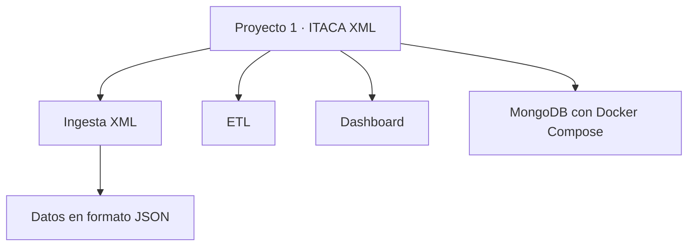
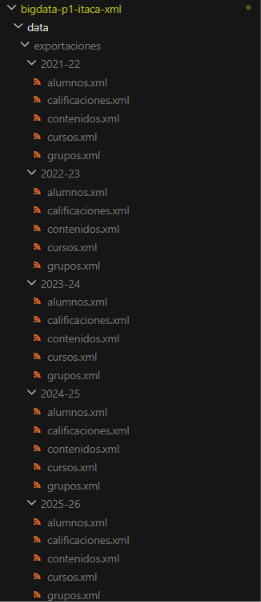
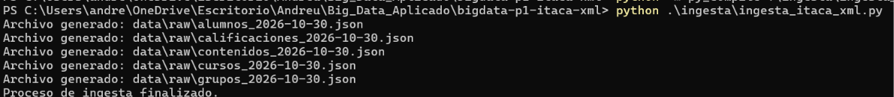

# Proyecto 1 · ITACA XML

## Descripción y objetivo

Este repositorio corresponde al Proyecto 1 del módulo de Big Data.

El proyecto se basa en datos de ITACA relacionados con estudiantes, cursos, contenidos, grupos y calificaciones.

## Arquitectura



El diagrama muestra la estructura inicial del repositorio y sirve como referencia para la organización de los distintos componentes. Dicha estructura podrá evolucionar a medida que se desarrolle el proyecto.

## Estructura del repositorio

```text
bigdata-p1-itaca-xml/
├── data/
│   ├── exportaciones/
│   │   ├── 2021-22/
│   │   ├── 2022-23/
│   │   ├── 2023-24/
│   │   ├── 2024-25/
│   │   └── 2025-26/
│   └── raw/
├── ingesta/
│   └── ingesta_itaca_xml.py
├── etl/
├── dashboard/
├── evidencias/
│   ├── 01_script_ingesta.png
│   ├── 02_xml_exportaciones.png
│   ├── 03_ejecucion_ingesta.png
│   ├── 04_json_generados.png
│   └── 05_validacion_registros.png
├── .gitignore
├── docker-compose.yml
└── README.md
```

Las carpetas `data/exportaciones/` y `data/raw/` se utilizan para trabajar con los datos localmente.

Están excluidas del repositorio mediante `.gitignore`, por lo que los archivos XML y JSON no se suben a GitHub.

La carpeta `evidencias/` contiene las capturas realizadas durante la práctica.

## Entorno de trabajo

El repositorio incluye un archivo `docker-compose.yml` para desplegar una instancia de MongoDB mediante Docker Compose.

Para la ingesta se utiliza Python y la librería `xml.etree.ElementTree`, que permite leer y procesar los archivos XML.

## Fuentes de datos

Los datos proceden de las exportaciones XML de ITACA, organizadas por curso académico dentro de `data/exportaciones/`.

Cada carpeta contiene los archivos correspondientes a las cinco tablas utilizadas en el proyecto:

| Archivo XML          | Tabla          | Información                                                                                         |
| -------------------- | -------------- | --------------------------------------------------------------------------------------------------- |
| `alumnos.xml`        | Alumnos        | NIA, sexo, nacionalidad, provincia, municipio, enseñanza, curso, grupo, turno y datos de matrícula. |
| `calificaciones.xml` | Calificaciones | Evaluación, alumno, enseñanza, curso, contenido, bloque de contenido, nota numérica y tipo de nota. |
| `contenidos.xml`     | Contenidos     | Código, nombre en castellano y valenciano, enseñanza y curso.                                       |
| `cursos.xml`         | Cursos         | Código, nombre en castellano y valenciano, abreviatura, enseñanza y curso padre.                    |
| `grupos.xml`         | Grupos         | Código, nombre, enseñanza, turno, aula, capacidad, línea y modalidad.                               |

Las exportaciones disponibles corresponden a los cursos académicos 2021-22, 2022-23, 2023-24, 2024-25 y 2025-26.

## Ingesta de datos

La ingesta se realiza mediante el script `ingesta/ingesta_itaca_xml.py`.

El proceso recorre las carpetas de los cinco cursos académicos y lee los archivos XML de cada una de las tablas.

Los registros se acumulan por tabla y se guardan en archivos JSON dentro de `data/raw/`.

El campo `Anyo` se obtiene del atributo `curso` de la cabecera de cada XML.

### Anonimización del NIA

Para evitar conservar el NIA original, se utiliza una función basada en SHA-256 que devuelve los primeros 10 caracteres del hash.

La anonimización se aplica tanto al campo `NIA` de la tabla de alumnos como al campo `alumno` de las calificaciones.

El hash se calcula una sola vez por cada NIA y se reutiliza mediante una caché, manteniendo la misma referencia anonimizada entre ambas tablas.

### Validación de claves

Después de procesar los XML, se comprueba que las referencias de las calificaciones existan en las tablas correspondientes:

- El campo `alumno` debe existir en los NIA de la tabla de alumnos.
- El campo `contenido` debe existir en los códigos de la tabla de contenidos.

La validación registra los resultados mediante `logging`, diferenciando los errores de referencias a alumnos y a contenidos.

En la última ejecución se detectaron 133 calificaciones asociadas a 6 identificadores de alumno que no aparecen en ninguna de las cinco exportaciones disponibles. Se comprobó que esos identificadores tampoco aparecen en los XML originales de alumnos.

No se eliminan esas calificaciones: se conservan los registros y se deja constancia de la incidencia mediante un aviso en el log.

No se encontraron referencias a contenidos inexistentes.

### Archivos generados

La ejecución del script genera cinco archivos JSON:

- `alumnos_FECHA.json`
- `calificaciones_FECHA.json`
- `contenidos_FECHA.json`
- `cursos_FECHA.json`
- `grupos_FECHA.json`

Los archivos se guardan en `data/raw/` y contienen los registros acumulados de los cinco cursos académicos.

### Ejecución

Desde la raíz del repositorio se ejecuta:

```bash
python ingesta/ingesta_itaca_xml.py
```

El script muestra mediante logs los archivos procesados, el número de registros leídos, los resultados de la validación, los archivos JSON generados y el estado final del proceso.

## Evidencias

### 1. Script de ingesta

Captura del script utilizado para procesar los archivos XML.


### 2. Exportaciones XML

Captura de las carpetas con los archivos XML de los cinco cursos académicos.



### 3. Ejecución de la ingesta

Captura de la ejecución del script y de los mensajes de logging.



### 4. Archivos JSON generados

Captura de los cinco archivos JSON resultantes de la ingesta.


### 5. Validación de registros

Captura de las comprobaciones realizadas sobre las referencias de alumnos y contenidos.


## Estado actual

- [x] Repositorio Git inicializado en la rama `main`.
- [x] Carpetas iniciales creadas.
- [x] Archivo `.gitignore` creado.
- [x] Archivo `docker-compose.yml` creado.
- [x] Contenedor de MongoDB iniciado.
- [x] Script de ingesta XML creado.
- [x] Datos de los cinco cursos académicos procesados.
- [x] NIA anonimizado en alumnos y calificaciones.
- [x] Hash del NIA reutilizado mediante una caché.
- [x] Cinco archivos JSON generados.
- [x] Logging incorporado para registrar la lectura, los errores y la escritura de archivos.
- [x] Validación de referencias entre alumnos, calificaciones y contenidos.
- [x] Incidencia de 133 calificaciones con 6 identificadores de alumno no encontrados identificada y documentada.
- [x] Capturas de las evidencias incorporadas al README.
