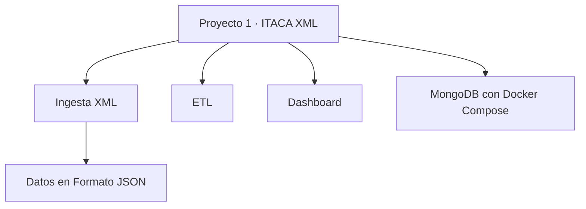

# Proyecto 1 · ITACA XML

## Descripción y objetivo

Este repositorio corresponde al Proyecto 1 del módulo de Big Data.

El proyecto se basa en datos de ITACA relacionados con estudiantes, cursos, contenidos, grupos y calificaciones

## Arquitectura



El diagrama muestra la estructura inicial del repositorio y sirve como referencia para la organización de los distintos componentes. Dicha estructura podrá evolucionar a medida que se desarrolle el proyecto.

## Estructura del repositorio

```text
bigdata-p1-itaca-xml/
├── data/
│   ├── exportaciones/
│   │   ├── 2021-22/
│   │   ├── 2022-23/
│   │   ├── 2023-24/
│   │   ├── 2024-25/
│   │   └── 2025-26/
│   └── raw/
├── ingesta/
│   └── ingesta_itaca_xml.py
├── etl/
├── dashboard/
├── evidencias/
│   ├── 01_script_ingesta.png
│   ├── 02_xml_exportaciones.png
│   ├── 03_ejecucion_ingesta.png
│   ├── 04_json_generados.png
│   └── 05_validacion_registros.png
├── .gitignore
├── docker-compose.yml
└── README.md
```

Las carpetas `data/exportaciones/` y `data/raw/` se usan para trabajar con datos localmente.

Están excluidas del repo mediante `.gitignore`. Los XML y JSON no se suben a GitHub.

La carpeta `evidencias/` contiene las capturas realizadas durante la práctica.

## Entorno de trabajo

El repositorio incluye un archivo `docker-compose.yml` para desplegar una instancia de MongoDB mediante Docker Compose.

Para la ingesta se utiliza Python y la librería `xml.etree.ElementTree`.

## Ingesta de datos

La ingesta se realiza con el script `ingesta/ingesta_itaca_xml.py`.

Se procesan los cinco cursos académicos disponibles:

- 2021-22
- 2022-23
- 2023-24
- 2024-25
- 2025-26

Para cada curso se leen los siguientes archivos XML:

| Archivo XML          | Tabla generada |
| -------------------- | -------------- |
| `alumnos.xml`        | Alumnos        |
| `calificaciones.xml` | Calificaciones |
| `contenidos.xml`     | Contenidos     |
| `cursos.xml`         | Cursos         |
| `grupos.xml`         | Grupos         |

Los registros de los cinco cursos se acumulan por tabla y se guardan en archivos JSON dentro de `data/raw/`.

El campo `Anyo` se obtiene del atributo `curso` de la cabecera de cada XML.

### Anonimización del NIA

Para evitar conservar el NIA original, se utiliza una función basada en SHA-256 que devuelve los primeros 10 caracteres del hash.

La anonimización se aplica tanto al campo `NIA` de la tabla de alumnos como al campo `alumno` de las calificaciones.

De esta forma, se mantiene la misma referencia anonimizada entre ambas tablas.

### Archivos generados

La ejecución del script genera cinco archivos JSON:

- `alumnos_FECHA.json`
- `calificaciones_FECHA.json`
- `contenidos_FECHA.json`
- `cursos_FECHA.json`
- `grupos_FECHA.json`

Los archivos se guardan en `data/raw/` y contienen los registros acumulados de los cinco cursos académicos.

### Ejecución

Desde la raíz del repositorio se ejecuta:

```bash
python ingesta/ingesta_itaca_xml.py
```

El script muestra por terminal los archivos generados y un mensaje al finalizar el proceso.

## Estado actual

- [x] Repositorio Git inicializado en la rama `main`.
- [x] Carpetas iniciales creadas.
- [x] Archivo `.gitignore` creado.
- [x] Archivo `docker-compose.yml` creado.
- [x] Contenedor de MongoDB iniciado.
- [x] Script de ingesta XML creado.
- [x] Datos de los cinco cursos académicos procesados.
- [x] NIA anonimizado en alumnos y calificaciones.
- [x] Cinco archivos JSON generados.
- [x] Comprobaciones iniciales de los datos realizadas.
