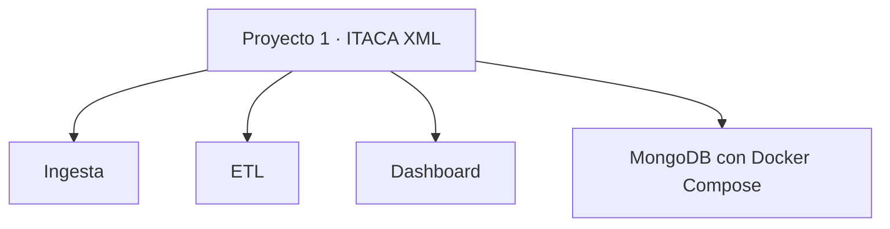

# Proyecto 1 · ITACA XML

## Descripción y objetivo

Este repositorio corresponde al Proyecto 1 del módulo de Big Data.

El proyecto se basa en datos de ITACA relacionados con estudiantes, cursos, módulos y calificaciones

## Arquitectura



El diagrama muestra la estructura inicial del repositorio y sirve como referencia para la organización de los distintos componentes. Dicha estructura podrá evolucionar a medida que se desarrolle el proyecto.

## Estructura del repositorio

```text
bigdata-p1-itaca-xml/
├── ingesta/
├── etl/
├── dashboard/
├── .gitignore
├── docker-compose.yml
└── README.md
```

## Entorno de trabajo

El repositorio incluye un archivo `docker-compose.yml` para desplegar una instancia de MongoDB mediante Docker Compose.

## Estado actual

- [x] Repositorio Git inicializado en la rama `main`.
- [x] Carpetas iniciales creadas.
- [x] Archivo `.gitignore` creado.
- [x] Archivo `docker-compose.yml` creado.
- [x] Contenedor de MongoDB iniciado.
- [ ] Desarrollo de los componentes del proyecto.
